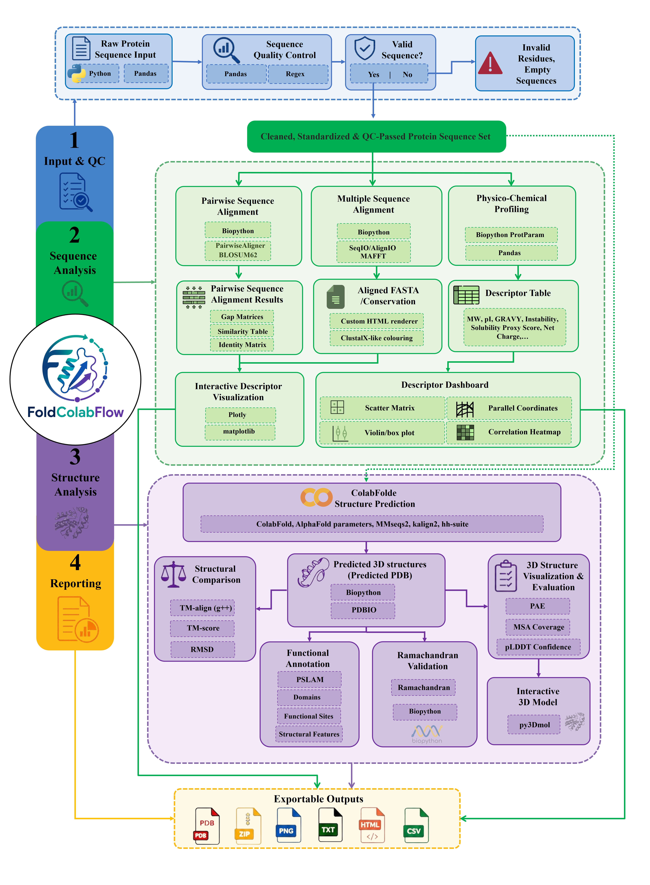

# FoldColabFlow

<p align="center">
  <strong>An integrated Google Colab workflow for protein sequence quality control, comparative sequence analysis, physicochemical profiling, structure prediction, validation, annotation, and reproducible export.</strong>
</p>

<p align="center">
  
  
  
  
</p>

---

<p align="center">
  
</p>

<p align="center">
  <em>FoldColabFlow: integrated sequence-to-structure protein analysis workflow.</em>
</p>

> **Research software status.** FoldColabFlow is being prepared as a citable research software resource. The accompanying manuscript has not yet been accepted; the formal article citation will be added when it becomes available.

## Overview

**FoldColabFlow** is a notebook-first protein analysis pipeline designed to connect sequence-level quality control with downstream sequence, descriptor, and structure analyses in a single reproducible workflow. It supports manually entered protein sequences, performs sequence validation and comparative analyses, computes theoretical physicochemical descriptors, runs ColabFold-based structure prediction, enables structural inspection and validation, and exports publication- and archive-friendly outputs.

The current demonstration package was run on two human protein sequences supplied for the project:

- **P01308 · INS_HUMAN** — 110 aa in the demo input (`Seq_1`)
- **A0A1B0GVQ0 · SPAR_HUMAN** — 90 aa in the demo input (`Seq_2`)

The repository includes representative alignment, physicochemical, structure-prediction, and Ramachandran outputs from this two-protein demonstration.

The demonstration dataset is intentionally kept separate from the PETase-like esterase case study described in the accompanying manuscript. Manuscript-specific sequence and structure files are stored under `manuscript_case_study/` to distinguish the biological case study from the general software demonstration.

## Workflow

FoldColabFlow is organized into four high-level stages: **Input & QC**, **Sequence Analysis**, **Structure Analysis**, and **Reporting**.

## Workflow modules

| Workflow module | Main purpose | Core packages / tools | Main outputs |
|---|---|---|---|
| **Input and sequence quality control** | Prepare manually entered protein sequences and flag problematic inputs. | `pandas`, `re`, `IPython.display` | Accepted sequences, sequence identifiers, quality-warning tables |
| **Sequence alignment and similarity analysis** | Perform pairwise, reference-based, and multiple sequence alignment. | Biopython `PairwiseAligner`, BLOSUM62, MAFFT, `pandas` | Pairwise summaries, identity/similarity/gap matrices, MSA files, HTML reports, ZIP archives |
| **Physicochemical profiling and descriptor visualization** | Calculate theoretical protein descriptors and visualize their variation. | Biopython `ProteinAnalysis`, `pandas`, Plotly, Matplotlib | Descriptor tables, amino-acid composition, statistical summaries, interactive plots, PNG/SVG figures |
| **Structure prediction and 3D visualization** | Predict protein structures and inspect model-confidence information. | ColabFold, AlphaFold2, MMseqs2, `py3Dmol` | PDB structures, confidence plots, PAE plots, coverage plots, ZIP archives |
| **Structure validation, functional annotation and structural comparison** | Examine backbone geometry, identify sequence-based annotations, and compare structures. | `ramachandraw`, PSALM, Biopython, TM-align | Ramachandran plots, PSALM annotations, TM-score/RMSD tables |
| **Integrated output generation and reproducibility** | Organize, export, and archive analysis outputs. | `pandas`, `json`, `zipfile`, Google Drive integration | CSV, FASTA, TXT, PDB, PNG, SVG, HTML, JSON, TSV, ZIP |

## Key capabilities

### 1. Input and sequence QC

- Manual input for multiple protein sequences.
- Standardization and validation of protein sequences before downstream processing.
- Detection and reporting of invalid residues, empty entries, and sequence-level warnings.

### 2. Sequence alignment and similarity

- Global pairwise alignment with Biopython `PairwiseAligner`.
- BLOSUM62-based similarity scoring with affine gap penalties.
- All-vs-all and optional reference-based summaries.
- Identity, similarity, and gap matrices.
- MAFFT multiple sequence alignment.
- Exportable FASTA, text, CSV, HTML, and ZIP outputs.

### 3. Physicochemical profiling

- Molecular weight and theoretical pI.
- GRAVY and hydropathy-related descriptors.
- Net charge at pH 7 and charge density.
- Instability index, aromaticity, and aliphatic index.
- Extinction coefficients and cysteine content.
- Amino-acid composition.
- A clearly labelled sequence-derived solubility proxy.
- Interactive Plotly visualizations and high-resolution PNG/SVG exports.

### 4. Structure prediction

- ColabFold/AlphaFold2-based structure prediction.
- MMseqs2-based MSA generation.
- Optional template support.
- Per-sequence PDB, score JSON, PAE, pLDDT, and coverage outputs.
- Interactive `py3Dmol` structure viewing.

### 5. Structural validation and annotation

- Ramachandran/backbone torsion analysis.
- PSALM-based functional/domain annotation workflow.
- TM-align structural comparison with TM-score and RMSD extraction.

### 6. Reporting and export

- Structured output directories and downloadable ZIP archives.
- Machine-readable CSV/TSV/JSON outputs.
- Human-readable HTML reports.
- Publication-oriented static figures.
- Notebook DataFrames for direct downstream analysis.

## Quick start

### Recommended environment

FoldColabFlow is designed primarily for **Google Colab**, where the notebook installs or configures required software during execution.

A GPU runtime is strongly recommended for the structure-prediction stage.

An internet connection is required for downloading dependencies, model parameters, and accessing external computational resources.

### Run the notebook

1. Open [`FoldColabFlow.ipynb`](FoldColabFlow.ipynb) in Google Colab.
2. Select a Python runtime and enable GPU acceleration when required.
3. Run the notebook cells in their intended order.
4. Mount Google Drive if persistent storage is desired.
5. Enter protein sequences in the **Protein Sequence Input** section.
6. Review sequence QC results before continuing.
7. Run the sequence alignment and physicochemical analysis modules.
8. Run ColabFold-based structure prediction and visualization as required.
9. Perform Ramachandran analysis, PSALM annotation, and TM-align comparisons when needed.
10. Download or archive generated outputs.

> **Important:** The notebook contains its own installation and dependency-management commands. Users following the standard Google Colab workflow generally do not need to perform a separate installation before executing the notebook.

## Installation and Dependencies

FoldColabFlow uses a combination of Python packages, external bioinformatics tools, and computational resources.

To improve transparency and facilitate reproducibility, the repository provides two complementary installation reference files.

### Python dependencies — `requirements.txt`

The [`requirements.txt`](requirements.txt) file documents the principal Python dependencies used by FoldColabFlow.

These include packages for:

- Protein sequence processing and alignment.
- Physicochemical descriptor calculation.
- Data organization and reporting.
- Interactive and static visualization.
- Protein structure prediction.
- Ramachandran analysis.
- Protein sequence annotation.

For users preparing a separate Python environment, the dependencies can be installed using:

```bash
python -m pip install -r requirements.txt
```

**However, this command is not required for the standard Google Colab workflow**, because the notebook already includes installation procedures.

The requirements file is a dependency reference and does not necessarily represent a complete, version-locked reproduction of the original Google Colab environment.

### Complete installation guide — `INSTALLATION.md`

The [`INSTALLATION.md`](INSTALLATION.md) file provides a detailed inventory of installation commands implemented in the FoldColabFlow notebook.

The guide documents:

1. Python package installation using pip.
2. MAFFT installation for multiple sequence alignment.
3. ColabFold installation from its GitHub repository.
4. Conditional JAX and associated backend dependencies.
5. Optional Miniforge/Conda-based installation procedures.
6. HH-suite and Kalign2 for optional template-related processing.
7. OpenMM and PDBFixer for optional Amber refinement.
8. AlphaFold model-parameter downloads.
9. Ramachandran analysis dependencies.
10. PSALM functional annotation dependencies.
11. TM-align source download and compilation.
12. Repeated and conditional installation commands.
13. Software-version and execution-environment considerations.

The installation guide reflects the commands already implemented in the notebook. It does not require changes to the existing notebook source code.

### Which installation method should users follow?

| Use case | Recommended procedure |
|---|---|
| Standard execution in Google Colab | Open the notebook and execute its built-in installation cells |
| Reviewing the Python dependencies | Consult `requirements.txt` |
| Inspecting installation commands and optional tools | Consult `INSTALLATION.md` |
| Preparing a separate Python environment | Use `requirements.txt` together with the external-tool instructions in `INSTALLATION.md` |
| Reproducing manuscript analyses | Use the manuscript-specific inputs and retain the corresponding execution configurations and software-version information |

### Avoiding duplicate installations

Some packages, including Biopython and pandas, are installed in multiple notebook modules. The ColabFold setup also contains installation and fallback procedures.

These commands are retained in the notebook to preserve its existing implementation.

Users should generally **avoid running both `pip install -r requirements.txt` and all notebook installation cells as separate setup procedures**, because doing so may unnecessarily repeat installations or alter resolved dependency versions.

### Software version considerations

The current notebook specifies versions for certain dependencies, while others are installed without fixed version constraints.

Consequently, software versions may vary across Google Colab sessions.

For reproducible computational reporting, users should preserve the versions of Python and installed dependencies, ColabFold configuration files, runtime information, model settings, and relevant output artifacts.

The installation reference files document software requirements but do not independently establish exact reproduction of every previously generated result.

## Demonstration data and reproducibility snapshot

The included demonstration outputs were generated from two sequences (`Seq_1`, 110 aa; `Seq_2`, 90 aa).

### Alignment run

The archived alignment report records:

| Component | Demo value |
|---|---|
| Python | 3.12.13 |
| Biopython | 1.88 |
| pandas | 2.2.2 |
| MAFFT | v7.490 |
| Pairwise mode | Global |
| Substitution matrix | BLOSUM62 |
| Gap model | Affine |
| Gap open / extension | -10.0 / -0.5 |
| MSA strategy | `mafft --auto --amino` |

For the included two-sequence comparison, the archived pairwise summary reports **19.51% full-column identity**, **26.83% full-column similarity**, and **37.40% gap-containing alignment columns** under the recorded settings.

### Structure-prediction run

The supplied ColabFold configuration files record:

| Parameter | Demo value |
|---|---|
| ColabFold | 1.6.2 |
| ColabFold commit | `f41090fe3da60283e682f1f284d2c2a1952c519d` |
| Model type | `alphafold2_ptm` |
| Models | 5 |
| Recycles | 3 |
| MSA mode | `mmseqs2` |
| Templates | Disabled |
| Relaxation | Disabled |
| Ranking | pLDDT |
| Random seed | 0 |

The ColabFold result folders also include upstream-generated `cite.bibtex` files; retain these and cite the relevant upstream methods when publishing results.

## Manuscript case-study data

The PETase-like esterase analyses reported in the accompanying manuscript are maintained separately from the two-protein demonstration dataset.

The six amino-acid sequences used in the manuscript case study (`Seq_1`–`Seq_6`) are provided in:

[`manuscript_case_study/PETase_like_esterase_candidates.fasta`](manuscript_case_study/PETase_like_esterase_candidates.fasta)

This separation is intentional:

- `examples/demo/` contains the general FoldColabFlow demonstration.
- `manuscript_case_study/` contains manuscript-specific protein sequences and derived structural files.

The predicted structures corresponding to the manuscript case study are organized using the following filenames:

- `Seq_1.pdb`
- `Seq_2.pdb`
- `Seq_3.pdb`
- `Seq_4.pdb`
- `Seq_5.pdb`
- `Seq_6.pdb`

Additional manuscript-specific outputs and execution records can be deposited in `manuscript_case_study/` to support further inspection and independent reproduction.

## Repository layout

```text
FoldColabFlow/
├── README.md
├── INSTALLATION.md
├── requirements.txt
├── LICENSE
├── NOTICE
├── CITATION.cff
├── FoldColabFlow_Workflow.png
├── FoldColabFlow.ipynb
├── .gitignore
│
├── notebooks/
│   └── ... notebook-related files
│
├── assets/
│   └── ... repository assets
│
├── examples/
│   └── demo/
│       └── ... general two-protein demonstration files
│
└── manuscript_case_study/
    ├── PETase_like_esterase_candidates.fasta
    ├── Seq_1.pdb
    ├── Seq_2.pdb
    ├── Seq_3.pdb
    ├── Seq_4.pdb
    ├── Seq_5.pdb
    └── Seq_6.pdb
```

The `examples/demo/` directory should remain dedicated to the general software demonstration.

Manuscript-specific files should remain under `manuscript_case_study/`, allowing readers to distinguish the demonstration dataset from the case-study data.

## Outputs

Depending on the enabled modules, FoldColabFlow can generate:

- **Sequence analysis:** FASTA, CSV, TXT, HTML, ZIP
- **Physicochemical analysis:** CSV, JSON, HTML, PNG, SVG, ZIP
- **Structure prediction:** PDB, A3M, JSON, PNG, ZIP
- **Validation and annotation:** PNG, TSV, CSV, TXT
- **Structural comparison:** tabular TM-score/RMSD results
- **Integrated reporting:** HTML reports and structured archives
- **Manuscript case study:** FASTA inputs, predicted PDB structures, and associated computational outputs

## Scientific scope and limitations

FoldColabFlow integrates established bioinformatics tools; it does not replace experimental validation.

Sequence-derived descriptors are theoretical estimates, structure confidence metrics must be interpreted in context, functional annotations are model/resource dependent, and predicted structures should not be treated as experimentally determined coordinates.

The solubility proxy implemented in the workflow is a heuristic, sequence-derived screening score rather than an experimentally validated measure of soluble protein expression.

Structural similarity, predicted ligand interactions, or sequence-based annotations alone do not demonstrate PET-depolymerizing activity.

This software is intended for research and educational use and has **not** been validated for clinical diagnosis, treatment decisions, or other safety-critical use.

## Citation

If you use FoldColabFlow in a thesis, preprint, paper, report, or other scholarly output, please cite the **software release** using the metadata in [`CITATION.cff`](CITATION.cff).

The accompanying FoldColabFlow manuscript has not yet been accepted. Once a formal article citation and DOI are available, this section and `CITATION.cff` can be updated to make the article the preferred citation.

For a public release, the recommended citation workflow is:

1. Finalize the author list and ORCID identifiers in `CITATION.cff`.
2. Create a versioned GitHub release (for example, `v1.0.0`).
3. Archive that release in Zenodo to obtain a software DOI.
4. Add the DOI to `CITATION.cff` and this README.
5. After the manuscript is published, add the article under `preferred-citation` while keeping the software DOI/version citable.

Please also cite the upstream scientific software and methods used for the analyses, including ColabFold/AlphaFold, MAFFT, Biopython, TM-align, PSALM, and other relevant dependencies, according to their own citation guidance.

## License

FoldColabFlow's original repository code and documentation are released under the **Apache License 2.0**. See [`LICENSE`](LICENSE).

This is a permissive open-source license that allows reuse, modification, and redistribution under its terms. **Academic citation is requested through `CITATION.cff`, but scholarly citation is separate from the software-license conditions.**

Third-party tools, model parameters, databases, downloaded source files, and example data are **not relicensed by FoldColabFlow** and remain subject to their respective upstream licenses and terms.

Users are responsible for complying with those terms.

## Contributing

Contributions that improve robustness, reproducibility, documentation, testing, or scientific reporting are welcome.

For substantial changes, open an issue first so the scope and expected behavior can be discussed.

## Project status

FoldColabFlow is under active research development. Interfaces, output schemas, dependency versions, and default parameters may change before the first stable release.

---

**FoldColabFlow** — integrated protein sequence-to-structure analysis in a reproducible Colab workflow.
